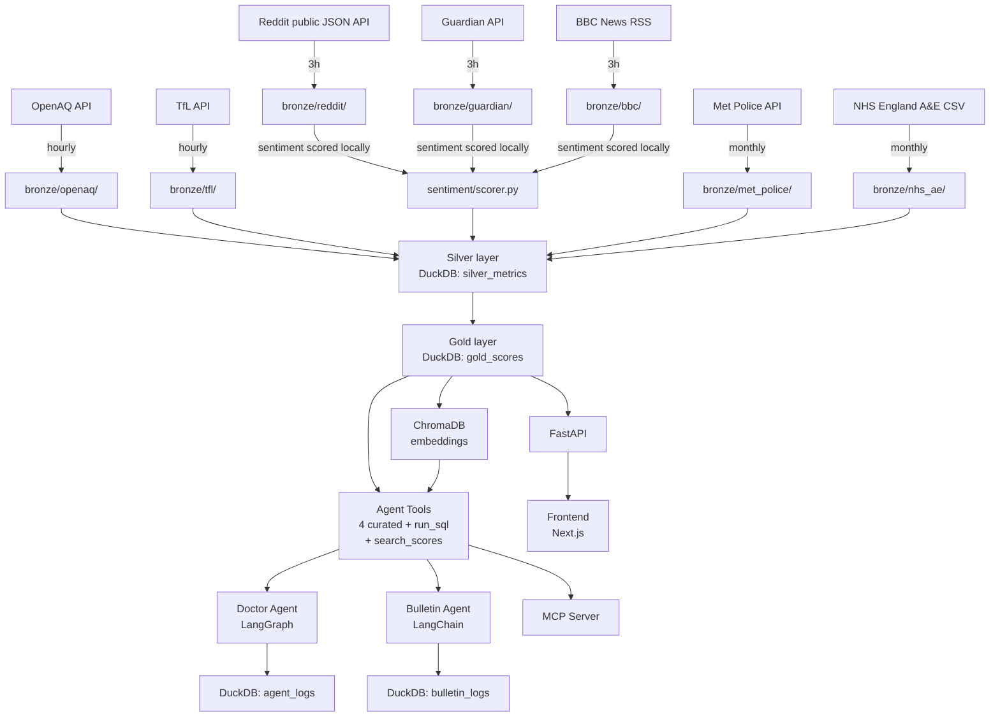

# Data Lineage

## Pipeline flow

## Lineage fields

Every Silver and Gold record carries:

| Field            | Description                                                                       |
| ---------------- | --------------------------------------------------------------------------------- |
| `source`         | Origin API (`openaq`, `tfl`, `reddit`, `guardian`, `bbc`, `met_police`, `nhs_ae`) |
| `ingested_at`    | UTC timestamp of when the raw data was fetched                                    |
| `pipeline_stage` | `bronze`, `silver`, or `gold`                                                     |

## Transformations

| Stage       | File                 | What happens                                                                 |
| ----------- | -------------------- | ---------------------------------------------------------------------------- |
| Bronze      | `pipeline/bronze.py` | Raw API response saved as timestamped JSON — no transformation               |
| Silver      | `pipeline/silver.py` | Parsed, validated, normalised to 0–100 score, mapped to ONS borough code     |
| Gold        | `pipeline/gold.py`   | Per-borough weighted average across all four signals; embedded into ChromaDB |
| Embed       | `pipeline/embed.py`  | Gold rows converted to text descriptions and upserted into ChromaDB for RAG  |
| Agent Tools | `agents/tools/`      | 4 curated DuckDB queries + 1 guarded `run_sql` + 1 RAG `search_scores`       |

